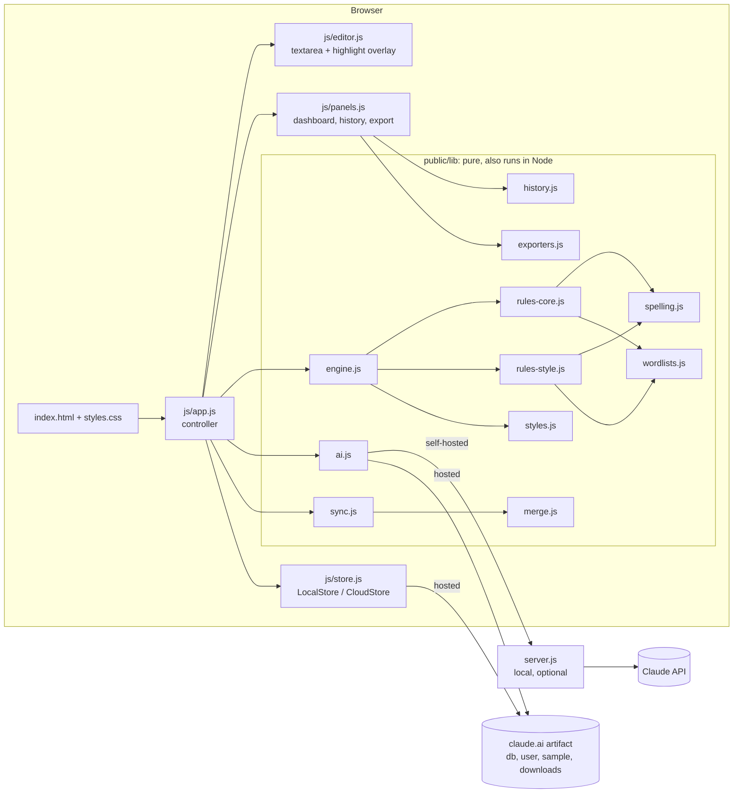
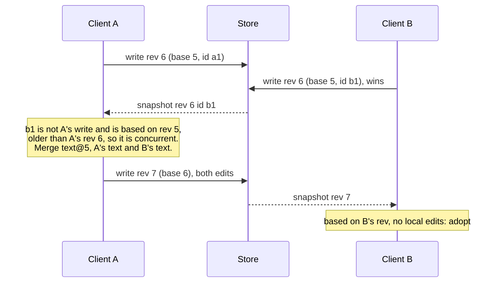
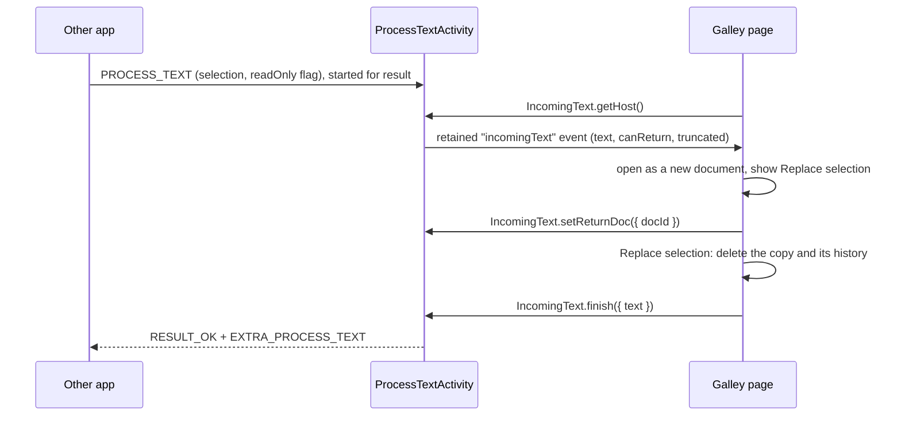

# Galley architecture

How the proofreader is put together, the contracts between its parts, and
what an enterprise version would still need.

## Module map



Everything under `public/lib` is a UMD module: a browser global
(`window.GalleyEngine`) and a CommonJS export (`require('./engine')`). The
tests drive the same code the page runs.

## Rule engine

`engine.check(text, { dialect, style, mode, poetry })` returns
`{ issues, profile, stats }`.

1. **Profile.** `styles.resolveProfile` merges the dialect (spelling system,
   quote style, date order and so on) with the style guide. A guide value can
   be explicit, `'dialect'` (defer to the dialect), or `{ us, uk }` (depends on
   the dialect family).
2. **Context.** The engine finds quotation spans (straight, curly, single and
   double, including unclosed speech that runs on to the next paragraph),
   protected ranges (URLs, emails, inline code) and sentence boundaries that
   ignore abbreviations.
3. **Rules.** Each rule is `{ id, category, run(ctx) }` and reports with
   `ctx.add({ start, end, replacement, severity, message, explanation, voice })`.
   `voice: 'soft'` marks dialect or informal usage; `voice: 'dialogue'` marks a
   real error a character might still say. In creative mode the engine drops or
   downgrades these.
4. **Finalize.** Issues are sorted, de-duplicated and given an `id` and an
   ignore `key`.

An issue with `start === end` is an insertion; `replacement === ''` is a
deletion; `replacement === null` is advice only.

## AI integration

The page builds a prompt from structured inputs with `ai.buildProofreadPrompt`.
It sends the manuscript in chunks of about 12,000 characters, split at
paragraph boundaries. Rule findings inside the chunk go along so Claude does
not repeat them. Claude replies with quotes, not offsets. `ai.locateIssues`
finds each quote in the text, using the quoted sentence to tell repeats apart,
and drops any it cannot find. After edits, `relocateIssues` finds each AI
finding again or drops it.

Two transports share that prompt:

- **Hosted.** The `sample` capability runs the call on the viewer's own Claude
  account (`modelTier: 'default'`). The viewer is asked once for permission.
- **Self-hosted.** `server.js` calls the Messages API with the official SDK.
  The request uses model `claude-opus-5-5` with effort `medium`, a JSON-schema
  output format (`ai.ISSUES_SCHEMA`), streaming, and server-side refusal
  fallback (`fallbacks: "default"`, beta `server-side-fallback-2026-07-01`).

### Server API

`GET /api/status`

```json
{ "ai": true, "model": "claude-opus-5-5" }
```

`POST /api/ai` with a proofread body:

```json
{
  "kind": "proofread",
  "text": "one chunk, at most 24,000 characters",
  "options": { "dialect": "en-GB", "style": "harts", "mode": "creative", "poetry": false },
  "flow": true,
  "findings": [{ "text": "teh", "message": "Misspelled" }]
}
```

The reply matches `ISSUES_SCHEMA`:

```json
{
  "issues": [{
    "quote": "they was",
    "context": "The cat sat on the mat they was on.",
    "action": "replace",
    "replacement": "they were",
    "category": "grammar",
    "severity": "error",
    "message": "Subject and verb disagree.",
    "explanation": "A plural subject takes a plural verb."
  }]
}
```

`POST /api/ai` with `{ "kind": "summary", "stats": <history.summarize()>, "options": {...} }`
returns `{ headline, trend, patterns: [{ title, detail, example }], focus: [] }`.

Errors come back as `{ "error": "message" }`:

| Status | Meaning |
|---|---|
| 400 | Bad JSON, empty text, unknown kind, or a request Claude rejected |
| 401, 403 | The server's credentials were rejected or cannot use the model |
| 413 | Body over 512 KB, chunk too long, or too many findings for one reply |
| 422 | Claude declined to review the passage |
| 429 | Rate limited |
| 502 | Claude unreachable, or the reply could not be parsed |
| 503 | No SDK or credentials on this server |

The server only serves files under `public/`, rejects path traversal, and
sends `Content-Security-Policy`, `X-Content-Type-Options`, `X-Frame-Options`
and `Referrer-Policy` headers. It never accepts a prompt from the browser.

## Storage and sync

`store.js` exposes one interface with two implementations:

| | LocalStore | CloudStore (hosted) |
|---|---|---|
| Documents | `localStorage` `galley.doc.<id>` | `docs/<id>` |
| Versions | `galley.versions.<id>` (last 30) | `docs/<id>/versions/<vid>` |
| Activity | `galley.activity` (last 300) | `activity/<userId>/days/<YYYY-MM-DD>` |
| Dashboard history | `galley.history` | `data/users/<userId>/history` (private to each person) |
| Live updates | `storage` event across tabs | `onSnapshot` across devices and people |

### Sync protocol

Every write carries `{ text, rev, baseRev, writeId, updatedBy, updatedAt }`.
The store is last-writer-wins, so the client does the merging
(`sync.js`, `merge.js`):



- Each client remembers the text of its last 25 revisions, so it can merge
  against the exact base the other writer started from.
- `merge3` aligns paragraphs with a longest-common-subsequence diff. Changes
  to different paragraphs combine. When both sides changed the same paragraph
  differently, the local wording stays and the other side's full text is saved
  as a version with the reason "Teammate's wording", so nothing is lost.
- Edits made offline are mirrored to `localStorage`. On reconnect they are
  saved. If the document moved on meanwhile, they are saved as an "Offline
  edits" version instead of overwriting.

### Hosted capabilities

Publish `dist/galley.html` with:

```json
{
  "sample": {},
  "db": {
    "rules": [
      { "path": "activity", "read": "admin", "write": "owner" },
      { "path": "activity/{self}", "read": "interact", "write": "interact" }
    ]
  },
  "user": { "scopes": ["profile"] },
  "downloads": true
}
```

Roles follow the artifact's sharing levels:

| Sharing level | Can |
|---|---|
| Viewer, Commenter | Read documents and findings, export. The editor is read-only. |
| Contributor | Edit, save versions, restore versions, see their own activity |
| Editor, Owner | All of the above, delete documents, read everyone's activity |

Delete is restricted to Editors and Owners in the interface. The store's
rules cannot tell a delete from an edit, so a determined Contributor could
still delete through the API. Versions keep the text either way.

## Mobile app

The Android app (`android/`, Capacitor 8) runs the same `public/` code in a
WebView. `scripts/build-mobile.js` produces `mobile/www`, the bundle that
ships in the app. It has bundled OFL fonts instead of Google Fonts, no
service worker or manifest, and `vendor/anthropic-sdk.js`, the official
TypeScript SDK bundled for the browser by esbuild. `npx cap sync` copies it
into the Android project.

The bundle's `index.html` carries a Content-Security-Policy whose only
network destination beyond the app itself is `https://api.anthropic.com`.
Capacitor injects its bridge script right after `<head>`, before the policy
applies, so `script-src` stays `'self'`. `capacitor.config.json` turns
Capacitor's logging off (`loggingBehavior: "none"`), so plugin calls, the API
key among them, never reach logcat, even in debug builds. Phones whose
system WebView is older than version 100 get `update-webview.html`, a plain
page that explains how to update it.

`public/js/native.js` is the bridge. It runs only when
`window.Capacitor.isNativePlatform()` is true and reaches plugins through
`window.Capacitor.Plugins`, which the native shell injects (no `@capacitor/core`
JavaScript, no bundler). A plugin a platform lacks is treated as absent and
its feature is turned off:

| Plugin | Source | Used for |
|---|---|---|
| `IncomingText` | `IncomingTextPlugin.java` | Text from the selection menu and Share (text or a `.txt` file); returning corrected text |
| `SecureKey` | `SecureKeyPlugin.java` | The Anthropic API key, AES-256-GCM under a non-exportable Android Keystore key |
| `Filesystem`, `Share` | `@capacitor/filesystem`, `@capacitor/share` | Exports: write to the app cache, then the system share sheet |
| `App` | `@capacitor/app` | Back button (predictive back on Android 16), saving on pause |
| `SystemBars` | Capacitor core | Edge-to-edge insets and keyboard resizing |

### Selected text round trip



`ProcessTextActivity` is a second `BridgeActivity` with the standard launch
mode. It runs in the calling app's task, because the `singleTask`
`MainActivity` could not return a result. Text goes back only when the
caller asked for a result, its field is editable, and the selection was not
cut short (senders cap it at 100,000 characters); otherwise the page offers
**Copy text**. **Replace selection** always sends the selection's own
document: if another document is open, the page switches back first. Back
in this window always returns to the other app. Choosing **Proofread** on
text inside Galley itself is cancelled with a short notice.

Share (`ACTION_SEND`) goes to `MainActivity`, which forwards text arriving
while it is open through `onNewIntent`. A shared `.txt` file (`EXTRA_STREAM`,
`content:` URIs only, 2 MB at most) is read off the main thread.

Each intent is imported once. When Android recreates an activity (after the
process was killed, or a configuration change), the activity marks its
intent consumed before the bridge replays it, so nothing is imported twice;
`ProcessTextActivity` keeps the selection's document id in its saved state,
and `getHost()` hands it back so the page reopens that document with its
return bar.

### On-device AI

The key is read from `SecureKey` again before every request, so a key
replaced or removed in the selection window takes effect in the main window
too. `SecureKey` deletes a stored value only when it can never be decrypted
(Keystore key gone or invalidated, data restored on another device); a
passing Keystore error is reported and the key is kept.

With a key saved, `native.js` gives the app an AI backend that calls
`client.beta.messages.stream(GalleyAI.buildRequest(...))` with
`dangerouslyAllowBrowser: true`. That is the same request the local server
sends, built by the same function. Requests go from the phone straight to
`api.anthropic.com`; there is no Galley server in between. SDK errors map to
the app's error codes: rejected key, rate limit, offline, refusal, stopped.

### Builds and signing

`.github/workflows/galley-android.yml` runs the tests, builds `mobile/www`,
syncs, checks the Gradle wrapper JAR against its official checksum (the
distribution's checksum is pinned in `gradle-wrapper.properties`), and
builds with Gradle. It fails if any native library appears in the APK (a
16 KB page-size guard) or if `apksigner` rejects it, uploads the APK (and
AAB) as unzipped files, then runs Android lint, whose findings appear as
annotations. With the `GALLEY_KEYSTORE_*` secrets it signs a release build;
`app/build.gradle` reads signing only from the environment, and the
optional `GALLEY_CERT_SHA256` variable makes the job fail on a build signed
with any other key. `versionCode` is the run number, so each signed build
installs over the previous one. Unsigned debug builds use a different key on
every run and cannot update one another.

## Not built, and what each would need

These requests need decisions or infrastructure outside this code, or they
conflict with other requests.

| Request | Status | What it needs |
|---|---|---|
| Single sign-on, two-factor sign-in | Provided by claude.ai when hosted there | Self-hosting needs an identity provider (OIDC/SAML) and a session layer in `server.js` |
| End-to-end encryption | Not built | Conflicts with the AI check and server-side analytics: neither can read encrypted text. Pick one: client-side encryption with AI off, or AI with encryption in transit and at rest only. |
| Encryption at rest, encrypted backups | Platform-managed when hosted | Self-hosting needs a database with encryption at rest and a backup policy |
| Email and push notifications | In-app notices only | A mail or push provider and per-person notification settings |
| GDPR and CCPA compliance | Data minimization in the design: dashboard history is private per person, no third-party analytics | A legal review, a data processing agreement, retention periods, and export and delete-my-data flows |
| "Comprehensive user behavior monitoring" | Deliberately not built | Conflicts with GDPR data minimization. The activity log records document actions only. |
| Load testing, monitoring, alerting, CI/CD | The repository's CI runs these tests | A deployment target. A static page plus an optional proxy needs little of this. |
| High-concurrency database tuning | Not applicable at this scale | A hosted store holds 25,000 documents per artifact. A larger team needs its own backend. |
